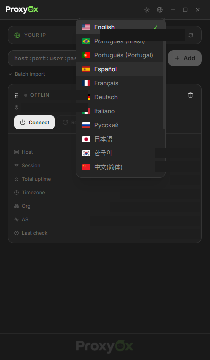

<p align="center">
  
</p>

<p align="center">
  <a href="https://github.com/henriqqw/Proxy0x/releases"></a>
  <a href="https://github.com/henriqqw/Proxy0x/releases"></a>
  <a href="https://go.dev/"></a>
  <a href="https://wails.io/"></a>
  <a href="https://react.dev/"></a>
</p>
<p align="center">
  <a href="https://github.com/henriqqw/Proxy0x/releases/latest">Download</a>
  · <a href="https://github.com/henriqqw/Proxy0x/issues">Report issue</a>
</p>

Windows desktop proxy manager. Route all browser traffic through HTTP or SOCKS5 proxies via a local proxy server, rotate IPs by session, run speed tests, organize proxies by group, and monitor latency and geolocation in real time. 16 languages, frameless dark UI with system tray. Built with **Go**, **Wails** and **React**.

## Screenshots

<p align="center">
  
  
  
</p>

## Downloads

| File | Description |
|------|-------------|
| `Proxy0x-Setup-1.0.0.exe` | Windows installer — language selector, install location, startup option |
| `Proxy0x.exe` | Standalone portable executable |

Download from the [latest release](https://github.com/henriqqw/Proxy0x/releases/latest).

### Installer features

- 14 language options for the installer UI
- Custom install location
- Desktop shortcut (optional)
- Start on Windows boot (optional)
- Full uninstaller via Add/Remove Programs

## Features

| Area | Details |
|------|---------|
| Protocols | HTTP and SOCKS5 proxy support |
| System proxy | Local proxy server routes all browser traffic through the selected proxy |
| Proxy management | Add single proxy, batch import, drag-to-reorder, remove, import/export JSON |
| Proxy groups | Tag proxies with groups, filter by group |
| Connection | Connect, disconnect (instant), rotate IP via session ID |
| Auto rotation | Configurable interval with presets (1m, 3m, 5m, 10m) or custom minutes |
| Speed test | Measure connect latency (ms) and download speed (Mbps) per proxy |
| Monitoring | Current IP, latency, live uptime timer, connection status badge |
| Geolocation | Country flag, city, region, ISP, timezone, AS number, organization |
| Health check | Automatic health checks every 3 minutes, Windows notification on proxy drop |
| Connection stats | Connected-at time, total uptime per proxy (persisted across sessions) |
| Encryption | AES-GCM credential encryption with per-machine key |
| Persistence | Proxies saved to `%APPDATA%/Proxy0x/proxies.json`, auto-restored on startup |
| i18n | 16 languages — EN, PT-BR, PT-PT, ES, FR, DE, IT, RU, JA, KO, ZH-CN, AR, HI, TR, TH, PL |
| System tray | Minimize to tray, language submenu, connect/disconnect/rotate all, quit |
| Interface | Frameless window, drag-to-reorder, loading skeletons, mouse back/forward navigation |

## Proxy format

```
host:port:user:pass
```

Residential proxies with geographic targeting (DataImpulse, etc.) are supported. IP rotation works by appending `_session-{id}` to the username — each unique session ID gets a different IP from the pool.

## Usage

1. Paste a proxy in `host:port:user:pass` format or use **Batch Import** for multiple at once.
2. Click **Connect** — the app starts a local proxy server and routes your browser traffic through it.
3. See the proxy's real IP, country flag, city, ISP and latency.
4. Use **Rotate** to get a new IP, or enable **Auto Rotation** in settings with a preset or custom interval.
5. Run **Speed Test** to measure connect latency and download speed.
6. Assign proxies to **groups** for filtering (click the group label in the expanded card).
7. Change language via the globe button in the title bar.
8. Close the window — the app minimizes to system tray. Click the tray icon to restore; use **Quit** to exit.

## How it works

Proxy0x runs a local HTTP/SOCKS5 proxy server on `127.0.0.1`. When you connect a proxy, the app:

1. Starts a local listener that accepts browser connections
2. Sets the Windows system proxy to point to this local server
3. Forwards all traffic through the selected upstream proxy
4. Tracks all connections for instant disconnect (no hanging)

```
Browser ──► Local Proxy (127.0.0.1) ──► Upstream Proxy ──► Internet
              │                              │
              │ HTTP CONNECT / SOCKS5        │ Residential IP
              │ Connection tracking          │ Session rotation
              ▼                              ▼
         Windows System Proxy          api.ipify.org (IP)
         (auto-configured)             ip-api.com (geo)
```

## Architecture

```
┌──────────────────────────────────────────────┐
│              Wails WebView2                  │
│  ┌────────────────────────────────────────┐  │
│  │    React + TypeScript + Tailwind       │  │
│  │    Lucide · @dnd-kit · i18n (16 lang)  │  │
│  └─────────────────┬──────────────────────┘  │
│                    │ bindings                 │
│  ┌─────────────────▼──────────────────────┐  │
│  │           Go Backend                   │  │
│  │  Proxy Manager · Local Proxy Server    │  │
│  │  HTTP & SOCKS5 · Health Checker        │  │
│  │  Speed Test · Auto Rotation            │  │
│  │  AES-GCM Crypto · Config Store         │  │
│  └─────────────────┬──────────────────────┘  │
│                    │                         │
│  ┌─────────────────▼──────────────────────┐  │
│  │          System Tray                   │  │
│  │    energye/systray · Language menu     │  │
│  └────────────────────────────────────────┘  │
└──────────────────────────────────────────────┘
         │              │              │
         ▼              ▼              ▼
   api.ipify.org   ip-api.com    Windows System
   (IP lookup)    (geolocation)  Proxy Settings
```

## Stack

| Layer | Technology | Role |
|-------|------------|------|
| Desktop | Go 1.25, Wails 2.16 | Frameless window, bindings, events, system tray |
| Frontend | React 18, TypeScript 5.6, Tailwind CSS 3 | Components, theme system, responsive layout |
| Drag & drop | @dnd-kit | Sortable proxy list with grip handles |
| Icons | Lucide React | Consistent monochrome iconography |
| Flags | flagcdn.com | Country flag images with lazy loading |
| Tray | energye/systray | System tray icon with language and control submenus |
| Crypto | AES-GCM (stdlib) | Credential encryption at rest |
| Network | net/http, net (stdlib) | HTTP & SOCKS5 proxy, connection pooling, health check |
| Installer | Inno Setup 6 | Windows installer with i18n and startup option |

## Development

### Prerequisites

- Go 1.25+
- Node.js 18+ and npm
- Wails CLI v2 (`go install github.com/wailsapp/wails/v2/cmd/wails@latest`)

### Dev mode with hot reload

```bash
cd frontend && npm install && cd ..
wails dev
```

Frontend updates instantly via Vite HMR. Go changes recompile and restart the app automatically.

### Production build

```bash
wails build -ldflags "-s -w"
```

Binary output: `build/bin/Proxy0x.exe`

### Installer build

Requires [Inno Setup 6](https://jrsoftware.org/isinfo.php).

```bash
iscc installer.iss
```

Generates `build/installer/Proxy0x-Setup-1.0.0.exe`.

## Project structure

```
Proxy0x/
├── main.go                      # Entry point, Wails config
├── app.go                       # App struct, Wails-bound methods, types
├── tray.go                      # System tray with language submenu
├── internal/
│   ├── proxy/
│   │   ├── server.go            # Local HTTP/SOCKS5 proxy server, connection tracking
│   │   └── system.go            # Windows system proxy settings (registry)
│   ├── crypto/
│   │   └── crypto.go            # AES-GCM credential encryption
│   └── config/
│       └── config.go            # App configuration (load, save, defaults)
├── installer.iss                # Inno Setup installer script
├── wails.json                   # Wails project config
├── build/
│   ├── bin/                     # Production binary
│   ├── installer/               # Installer output
│   └── windows/                 # Icons (icon.ico, tray.ico), manifest
├── assets/
│   ├── banner.png               # README banner
│   ├── icon.png                 # App icon (transparent)
│   └── screenshots/             # README screenshots
└── frontend/
    ├── src/
    │   ├── App.tsx              # Root component with DndContext, mouse navigation
    │   ├── i18n/
    │   │   ├── translations.ts  # 16 language translation sets
    │   │   └── LanguageContext.tsx
    │   └── components/
    │       ├── TitleBar.tsx      # Window controls, theme toggle, language selector
    │       ├── ProxyCard.tsx     # Sortable proxy card with stats, speed test, groups
    │       ├── ProxyForm.tsx     # Input and batch import
    │       ├── SettingsPage.tsx  # Auto rotation, import/export, language, about
    │       ├── ContextMenu.tsx   # Right-click language selector
    │       ├── StatusBadge.tsx   # Animated status indicator
    │       ├── MyIPBadge.tsx     # User's real IP display
    │       ├── FlagIcon.tsx      # Country flag from flagcdn
    │       └── EmptyState.tsx    # Empty state illustration
    ├── wailsjs/                  # Auto-generated Go <> TypeScript bindings
    └── tailwind.config.js        # Theme tokens (CSS variables)
```

## External services

| Service | Usage | Limit |
|---------|-------|-------|
| [api.ipify.org](https://www.ipify.org/) | Discover current IP through proxy | No documented limit |
| [ip-api.com](http://ip-api.com/) | IP geolocation (country, city, ISP, AS) | 45 req/min (free tier) |
| [flagcdn.com](https://flagcdn.com/) | Country flag images | CDN, no limit |

## Requirements

- Windows 10/11
- WebView2 Runtime (pre-installed on Windows 10 21H2+ and Windows 11)
