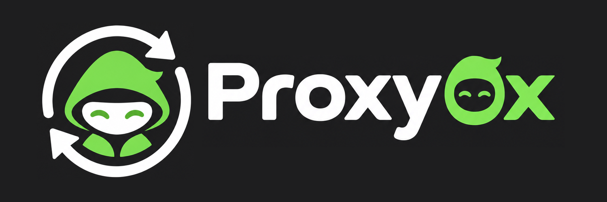
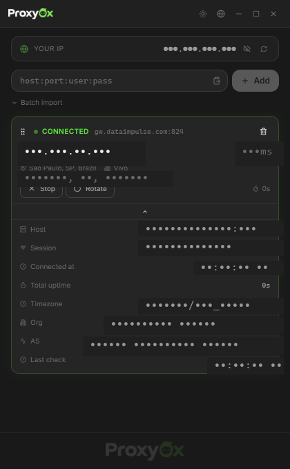
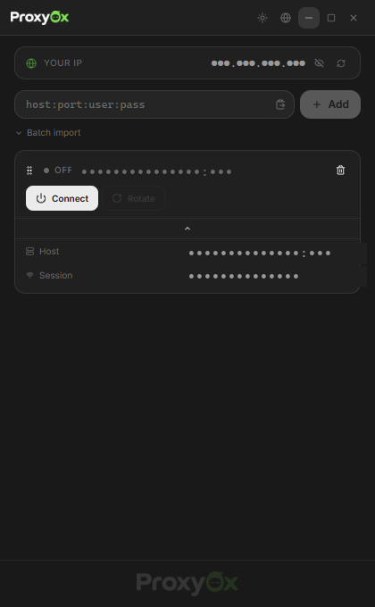

<p align="center">
  
</p>

<p align="center">
  <a href="https://github.com/henriqqw/Proxy0x/releases"></a>
  <a href="https://github.com/henriqqw/Proxy0x/releases"></a>
  <a href="https://go.dev/"></a>
  <a href="https://wails.io/"></a>
  <a href="https://react.dev/"></a>
</p>
<p align="center">
  <a href="https://github.com/henriqqw/Proxy0x/releases/latest">⬇ Download</a>
  · <a href="https://github.com/henriqqw/Proxy0x/issues">🐛 Report issue</a>
</p>

Lightweight Windows proxy manager widget. Add residential proxies, rotate IPs by session, monitor latency and geolocation in real time. Dark/light theme, 16 languages, frameless window with system tray. Built with **Go**, **Wails** and **React**.

## Screenshots

<p align="center">
  
  
</p>

## Downloads

| File | Description |
|------|-------------|
| `Proxy0x-win64-installer.exe` | Windows 64-bit installer (recommended) |
| `Proxy0x-win64.exe` | Windows 64-bit portable |
| `Proxy0x-win32.exe` | Windows 32-bit portable |
| `Proxy0x-arm64.exe` | Windows ARM64 portable |

Download from the [latest release](https://github.com/henriqqw/Proxy0x/releases/latest). No runtime or external dependencies required.

## Features

| Area | Details |
|------|---------|
| Proxy management | Add single proxy, batch import (paste multiple), drag-to-reorder, remove |
| Connection | Connect, disconnect, rotate IP via session ID |
| Monitoring | Current IP, latency (ms), live uptime timer, connection status |
| Geolocation | Country flag, city, region, ISP, timezone, AS number, organization |
| Health check | Auto-check every 90s with connection pooling, Windows notification on proxy drop |
| Connection log | Timestamped log of connect/disconnect/rotate events |
| Connection stats | Connected-at time, total uptime per proxy (persisted across sessions) |
| Encryption | AES-GCM credential encryption with per-machine key |
| Persistence | Proxies saved to `%APPDATA%/Proxy0x/proxies.json`, auto-restored on startup |
| i18n | 16 languages — EN, PT-BR, PT-PT, ES, FR, DE, IT, RU, JA, KO, ZH-CN, AR, HI, TR, TH, PL |
| Theme | Dark/light toggle, persisted preference |
| System tray | Minimize to tray, language submenu, connect/disconnect/rotate all, quit |
| Interface | Frameless window, drag-to-reorder, loading skeletons, Framer Motion animations |
| Accessibility | aria-labels on all interactive elements, keyboard navigation |

## Proxy format

```
host:port:user:pass
```

Residential proxies with geographic targeting (DataImpulse, etc.) are supported. IP rotation works by appending `_session-{id}` to the username — each unique session ID gets a different IP from the pool.

## Usage

1. Paste a proxy in the input field or use **Batch import** for multiple at once.
2. Click **Connect** to see the IP, location and latency.
3. Use **Rotate** to get a new IP on the same server.
4. Drag the grip handle to reorder proxies.
5. Toggle theme with the sun/moon button. Change language via the globe button or right-click context menu.
6. Close the window — the app minimizes to system tray. Click the tray icon to restore; use **Quit** to exit.

## Architecture

```
┌─────────────────────────────────────────┐
│             Wails WebView2              │
│  ┌───────────────────────────────────┐  │
│  │   React + TypeScript + Tailwind   │  │
│  │   Framer Motion · Lucide · i18n   │  │
│  │   @dnd-kit (drag & drop)          │  │
│  └──────────────┬────────────────────┘  │
│                 │ bindings               │
│  ┌──────────────▼────────────────────┐  │
│  │          Go Backend               │  │
│  │  Proxy Manager · Health Checker   │  │
│  │  AES-GCM Crypto · Config Store   │  │
│  │  Connection Pool · Log Manager    │  │
│  └──────────────┬────────────────────┘  │
│                 │                        │
│  ┌──────────────▼────────────────────┐  │
│  │         System Tray               │  │
│  │   energye/systray · Language      │  │
│  └───────────────────────────────────┘  │
└─────────────────────────────────────────┘
          │                    │
          ▼                    ▼
   api.ipify.org         ip-api.com
   (IP lookup)          (geolocation)
```

## Stack

| Layer | Technology | Role |
|-------|------------|------|
| Desktop | Go 1.25, Wails 2.16 | Frameless window, bindings, events, system tray |
| Frontend | React 18, TypeScript 5.6, Tailwind CSS 3 | Components, theme system, responsive layout |
| Animations | Framer Motion 11 | Transitions, loading states, layout animations |
| Drag & drop | @dnd-kit | Sortable proxy list with grip handles |
| Icons | Lucide React | Consistent monochrome iconography |
| Flags | flagcdn.com | Real country flag images with lazy loading |
| Tray | energye/systray | System tray icon with language and control submenus |
| Crypto | AES-GCM (stdlib) | Credential encryption at rest |
| Network | net/http (stdlib) | HTTP proxy client, connection pooling, health check |
| CI/CD | GitHub Actions | Auto-release with NSIS installer on push to main |

## Development

### Prerequisites

- Go 1.25+
- Node.js 18+ and npm
- Wails CLI v2 (`go install github.com/wailsapp/wails/v2/cmd/wails@latest`)

### Dev mode with hot reload

```bash
cd frontend && npm install && cd ..
wails dev
```

Frontend updates instantly via Vite HMR. Go changes recompile and restart the app automatically.

### Production build

```bash
wails build
```

Binary output: `build/bin/Proxy0x.exe`

### NSIS installer

```bash
wails build -nsis
```

Generates `build/bin/Proxy0x-amd64-installer.exe`.

## Project structure

```
proxy_ui/
├── main.go              # Entry point, Wails config
├── app.go               # Proxy manager, health checker, geo lookup, config, logging
├── crypto.go            # AES-GCM credential encryption
├── tray.go              # System tray with language submenu
├── wails.json           # Wails project config
├── .github/workflows/
│   └── release.yml      # CI: auto-tag, build, release on push to main
├── build/
│   ├── bin/             # Production binary
│   └── windows/         # Icon, manifest, metadata
└── frontend/
    ├── src/
    │   ├── App.tsx              # Root component with DndContext
    │   ├── i18n/
    │   │   ├── translations.ts  # 16 language translation sets
    │   │   └── LanguageContext.tsx  # React i18n context provider
    │   └── components/
    │       ├── TitleBar.tsx      # Window controls, theme toggle, language selector
    │       ├── ProxyCard.tsx     # Sortable proxy card with stats and controls
    │       ├── ProxyForm.tsx     # Input and batch import
    │       ├── ContextMenu.tsx   # Right-click language selector
    │       ├── StatusBadge.tsx   # Animated status indicator
    │       ├── MyIPBadge.tsx     # User's real IP display
    │       ├── FlagIcon.tsx      # Country flag from flagcdn
    │       └── EmptyState.tsx    # Empty state
    ├── wailsjs/                  # Auto-generated Go ↔ TypeScript bindings
    └── tailwind.config.js        # Theme tokens (CSS variables)
```

## External services

| Service | Usage | Limit |
|---------|-------|-------|
| [api.ipify.org](https://www.ipify.org/) | Discover current IP through proxy | No documented limit |
| [ip-api.com](http://ip-api.com/) | IP geolocation (country, city, ISP, AS) | 45 req/min (free tier) |
| [flagcdn.com](https://flagcdn.com/) | Country flag images | CDN, no limit |

## Known limitations

- HTTP proxy protocol only (not SOCKS5).
- Tested with DataImpulse proxies; other providers using `host:port:user:pass` format should work.
- Health check uses `api.ipify.org`, which may be blocked by some networks.
